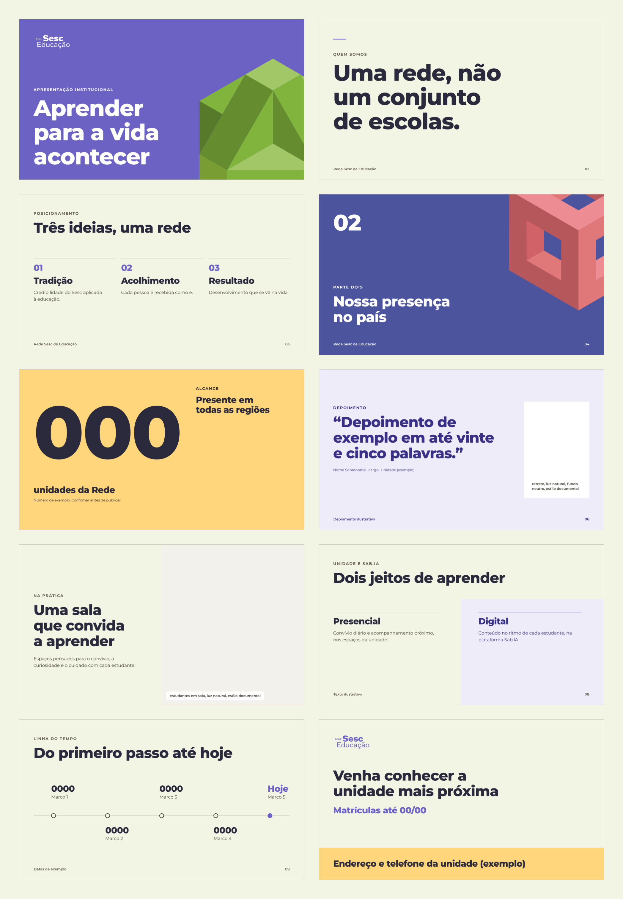

# Institutional deck — 16:9

Ten slides, one per canvas in [institutional-deck/](institutional-deck/) (`01.png` … `10.png`; in the
repository only — the npm package ships the contact sheet above, not the per-slide renders).
Source: [src/institutional-deck.html](src/institutional-deck.html). It uses one
[archetype](../archetypes.md) from every group of the story: open, argue, prove, compare, show,
close.

## Why it works

- **Big type does the work.** Statements are set at `display` size with nothing else competing;
  the "Uma rede, não um conjunto de escolas." slide is a headline and a page number.
- **Whitespace is a feature.** Most slides leave more than half the canvas empty. The pillars slide
  keeps its three columns low on the page so the headline has air above it.
- **Colour changes the rhythm, not the story.** Cream, brand purple, indigo, yellow and a purple tint
  alternate; each slide has one background hue (the closing slide adds one yellow band to cream), always with the text colour its pairing allows:
  white on purple and indigo, ink on yellow, tint-ink on the tint.
- **The cube is architecture.** It appears twice, never together: large on the cover and cropped by
  the top-right corner on the section divider, with the text well clear of it.
- **The set has structure.** An opening statement, three pillars, a divider, proof, voice, place,
  comparison, history and one clear ask. Strongest statements are first and last.
- **Honest placeholders.** `000`, `0000` and `00/00` are visibly unreal, the testimonial and
  portrait are labelled placeholders, and the footers say "exemplo" where a slide carries
  illustrative text.

## Spec

| Slide | Archetype | Group | Background |
| --- | --- | --- | --- |
| 1 | cover | Open | `--rse-color-primary` |
| 2 | statement | Argue | cream page |
| 3 | pillars | Argue | cream page |
| 4 | section | Open | `--rse-brand-indigo` |
| 5 | proof-number | Prove | `--rse-brand-yellow-light`, ink text |
| 6 | testimonial | Prove | `--rse-color-tint-purple`, tint-ink text |
| 7 | image-split | Show | cream page, image slot |
| 8 | comparison | Compare | cream page, one tinted half |
| 9 | journey | Show | cream page |
| 10 | ask | Close | cream page, one yellow band |

- Format `slide-16x9`: 1920 × 1080, margin 9% of the short side (97 px), twelve columns.
- Type at the format's fractions: display 0.14, h1 0.09, h2 0.055, body 0.028, caption 0.022.
- Every slide is under 40 words, every h1 headline under 60 characters and every display headline under 54 (the validator checks all three).

## Rubric

- R1: yes — each slide states one idea, and the selo or the repeated footer says who it is from
- R2: yes — headlines are 97–151 px against 30 px body copy, over 3 to 1 on every slide
- R3: yes — everything sits on the 97 px margin and the twelve-column grid; timeline labels start at their markers
- R4: yes — at least a third of every canvas is empty and nothing sits inside the 5% safe margin
- R5: yes — white on purple and indigo, ink on yellow and the tint-ink on the tint are all gated pairs; no white on an accent
- R6: yes — one cube per slide where used (cover, divider), cropped, clear of the text
- R7: yes — one band or field hue per slide; the brand purple as text or line colour (slide 10's date, the pillar numbers) is the brand itself, not a second hue
- R8: yes — each slide is at most 40 words, each headline within the format's limit, nothing below about 24 px (0.022 of the short side, above the 0.02 minimum)
- R9: yes — flat fields, hairlines and the official artwork only
- R10: yes — figures are `000`/`0000`/`00/00`, imagery is labelled slots and the placeholders are listed below
- R11: yes — pt-BR, sentence case, no emoji, Montserrat only
- R12: yes — the wordmark is the official file, unmodified, about 250 px wide, above the 150 px minimum, with at least X clear on every side and no Sesc signature

## Placeholders

Tell the user these need replacing or verifying before any public use:

- Slide 5: the unit count `000`, and the claim "Presente em todas as regiões" (verify).
- Slide 6: the testimonial text, the person and the portrait.
- Slide 7: the photograph (brief: estudantes em sala, luz natural, estilo documental) and the line about spaces.
- Slide 8: the descriptions of the two ways of learning are illustrative text.
- Slide 9: the five dates (`0000`) and milestone names.
- Slide 10: the enrolment date `00/00` and the unit address and phone.
