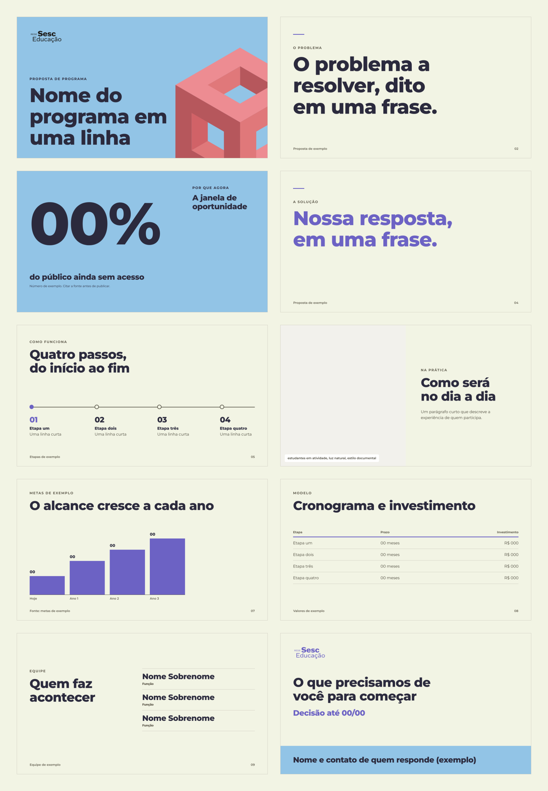

# Pitch deck — 16:9

A proposal for a new programme, told in ten slides: problem, why now, solution, how it works, in
practice, proof, model, team and the ask. One slide per canvas in [pitch-deck/](pitch-deck/) (repository only; the npm package ships the contact sheet above).
Source: [src/pitch-deck.html](src/pitch-deck.html). It shows the range of the system next to the
[institutional deck](institutional-deck.md): the band hue is blue instead of purple, and four
archetypes are new (process, evidence, data-table, contact).

## Why it works

- **A pitch is an argument.** Each slide advances one step of it, and the two statement slides
  (problem, solution) sit on either side of the numbers so the claim and the answer are never
  buried. The solution headline takes the brand purple, which marks the answer.
- **The number is the picture.** "Por que agora" is a single figure at about 450 px with a label,
  not a chart; the chart appears only where the point is a trend, with direct labels and one series.
- **One light hue.** Blue-light carries the cover, the "why now" figure and the closing band, always
  with ink text. Everything else is cream. Nothing is white-on-accent.
- **Reference slides stay quiet.** The table and the team list use hairlines and one rule in the
  accent colour; no fills, no zebra.
- **The ask is last and singular.** One decision, one date, one contact in the band at the bottom.

## Spec

| Slide | Archetype | Group | Background |
| --- | --- | --- | --- |
| 1 | cover | Open | `--rse-brand-blue-light`, ink text |
| 2 | statement (the problem) | Argue | cream page |
| 3 | proof-number (why now) | Prove | `--rse-brand-blue-light`, ink text |
| 4 | statement (the solution) | Argue | cream page, headline in `--rse-color-primary` |
| 5 | process | Argue | cream page |
| 6 | image-split | Show | cream page, image slot |
| 7 | evidence | Prove | cream page, `--rse-color-data-1` |
| 8 | data-table | Compare | cream page |
| 9 | contact (team) | Close | cream page |
| 10 | ask | Close | cream page, one blue-light band |

- Format `slide-16x9`: 1920 × 1080, margin 97 px, twelve columns; type at display 0.14, h1 0.09,
  h2 0.055, body 0.028, caption 0.022 of the short side.
- Every slide is under 40 words, every h1 headline under 60 characters and every display headline under 54 (checked by
  `scripts/check-composition.mjs`).
- One cube, on the cover, in pink on blue; no other slide has one.

## Rubric

- R1: yes — each slide carries one idea and the footer or the selo says whose it is
- R2: yes — headlines 97–151 px (the figure is 454 px) against 30 px body copy
- R3: yes — one 97 px margin and a twelve-column grid; process labels start at their markers
- R4: yes — at least a third of every canvas is empty and everything sits inside the safe margin
- R5: yes — ink on blue-light and cream, white-free accents, purple headline on cream is large text above 4.5:1
- R6: yes — one cube, on the cover, cropped, clear of the headline
- R7: yes — blue-light is the only band hue in the deck; the brand purple as text, rule or marker colour is the brand itself, not a second hue
- R8: yes — at most 40 words and headlines within the format's limits on every slide, nothing below about 24 px
- R9: yes — flat fields, hairlines and the official cube only
- R10: yes — every figure is `00`/`000`/`00/00`, imagery is a labelled slot, placeholders are listed below
- R11: yes — pt-BR, sentence case, no emoji, Montserrat only
- R12: yes — official wordmarks (black on blue, purple on cream), unmodified, about 250 px wide with clearspace

## Placeholders

Tell the user these need replacing or verifying before any public use:

- Slide 1: the programme name. Slides 2 and 4: the problem and solution sentences.
- Slide 3: the percentage `00%` and its source; the claim about the public without access.
- Slide 5: the four steps and their one-line descriptions.
- Slide 6: the photograph (brief: estudantes em atividade, luz natural, estilo documental) and the paragraph.
- Slide 7: the four values and the years; the whole chart is example data.
- Slide 8: the stages, durations and amounts.
- Slide 9: the three names and roles.
- Slide 10: the decision date and the contact.
