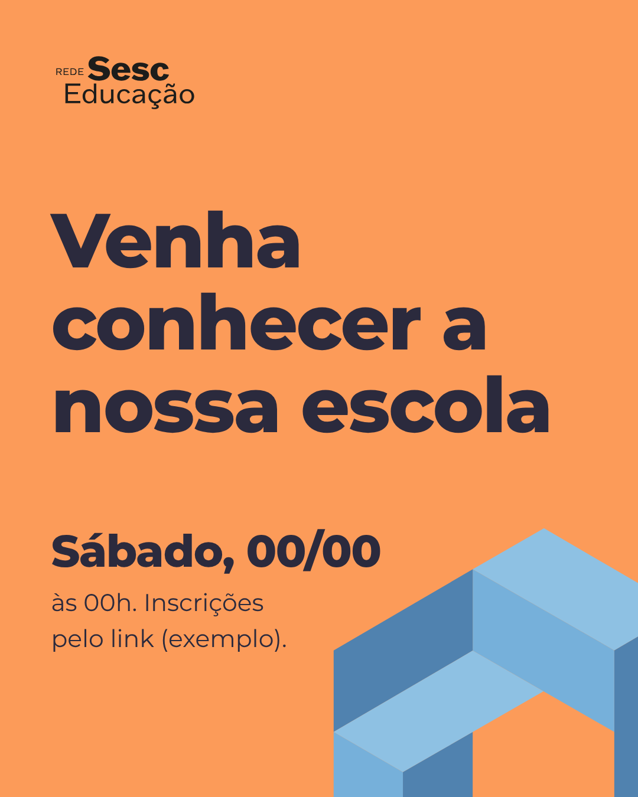

# Social card — 4:5

An open-day card for a feed: one invitation, one date, one cube. Rendered at 1080 × 1350 px.
Source: [src/social-card.html](src/social-card.html). Format `social-4x5`.

## Why it works

- **It survives a thumbnail.** Three lines of Extrabold at 130 px are legible at the size of a
  stamp. There are no other elements competing with them.
- **One colour field.** The light orange takes ink text well above the 4.5:1 floor (a pair the system gates); the cube is the official blue
  artwork, which contrasts with the orange without recolouring anything.
- **The cube is cropped, not placed.** It bleeds off the lower right edge and leaves the date block
  clear.
- **Everything critical is inside the safe area.** The wordmark, headline and date sit at least 86
  px from every edge; the feed can overlay the top and bottom 7% without hiding anything. Only the
  artwork bleeds.
- **One call to action.** The date and time, with how to sign up. The card does not try to
  say anything else.

## Spec

- Format `social-4x5`: margin 8% (86 px), safe area 7% (76 px), twelve columns.
- Type: h1 0.12 for the headline (the scale jump against body at 0.038 is 3.2 to 1), h2 0.07 for the
  date, body 0.038 for the time and link.
- Under 30 words (it has about 14) and a headline under 36 characters at h1 (it has 29).
- Archetype: `ask`. One motif: `assets/motifs/cube-hollow.svg`, official fills.

## Rubric

- R1: yes — invitation, date and school are clear in three seconds
- R2: yes — headline 130 px against 41 px body copy, 3.2 to 1
- R3: yes — one 86 px left margin shared by wordmark, headline and date
- R4: yes — about half the card is empty and all text sits inside the safe area
- R5: yes — ink on `--rse-brand-orange-light`, a gated pair
- R6: yes — one cube, cropped by the lower right corner, clear of the text
- R7: yes — one hue, orange-light, with ink text
- R8: yes — about 14 words, a 29-character headline, smallest text 41 px
- R9: yes — flat fields only
- R10: yes — date, time and link are placeholders and are listed below
- R11: yes — pt-BR, sentence case, no emoji, Montserrat only
- R12: yes — official black wordmark, unmodified, about 250 px wide (minimum 150 px), clearspace respected

## Placeholders

- The date `00/00` and the time `00h` of the open day.
- The sign-up link, which the card says is on a link, and the platform it will be posted to.
- "Venha conhecer a nossa escola": confirm that the unit is holding an open day.
