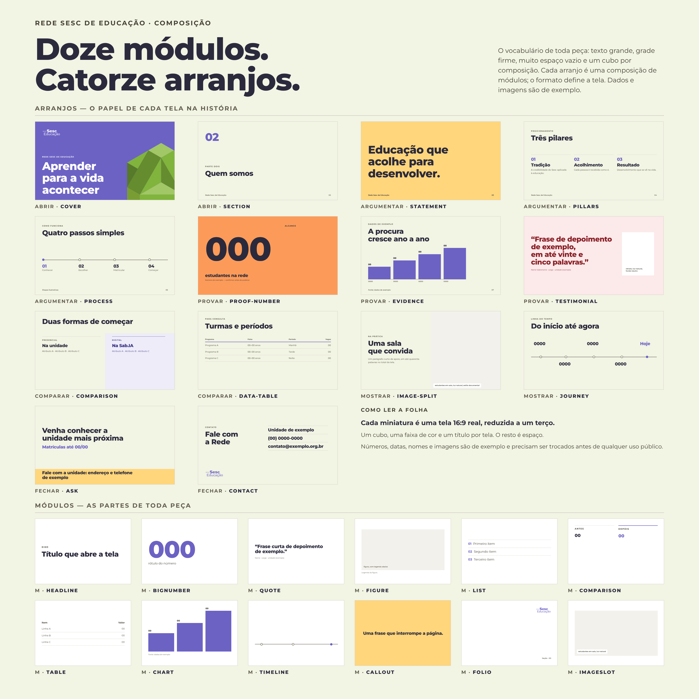

# Specimen sheet

The whole vocabulary on one image: the 14 [archetypes](../archetypes.md) as real 16:9 slides shown
at a third of their size, and the 12 [modules](../modules.md) beneath them. Source:
[src/specimen-sheet.html](src/specimen-sheet.html), styled by [src/exemplar.css](src/exemplar.css).

## Why it works

- **One idea, large.** The headline is the only large element and the sheet's job fits in it:
  "Doze módulos. Catorze arranjos."
- **The sheet follows its own rules.** Cream page, one hierarchy (eyebrow, headline, one support
  paragraph), a strict four-column grid, hairline rules, no shadows, no gradients.
- **Rhythm through the thumbnails.** Each archetype stands alone: three sit on colour (a purple band,
  a yellow statement, an orange figure), one on a tint, the rest on cream. Within each one there is
  one colour and one focus. Read together they show how a set alternates dense and empty canvases.
- **One cube, cropped.** The motif appears once, on the cover, bleeding off the right edge. No other
  thumbnail has one.
- **Honest placeholders.** Every figure is `000`, every date `0000`, every image a labelled box
  naming the shot. Nothing on the sheet is a Sesc fact.

## Spec

- Canvas: 3200 × 3200 px, a custom contact-sheet format (not one of `formats.json`). The thumbnails
  are `slide-16x9` at scale 1/3: type is 0.14 / 0.09 / 0.055 / 0.028 of the short side.
- Margin 160 px (5% of 3200), four columns of 640 px, 106 px gutters; modules in six columns of 440 px.
- Archetype ids in the file match `archetypes.md`; module ids match `modules.md`.
- Colours: the cream page, `--rse-color-primary`, the light accents with `--rse-brand-ink`, one tint
  with its ink, chart marks in `--rse-color-data-1`.

## Rubric

- R1: yes — the headline says what the sheet is, and the legend says how to read it, inside three seconds
- R2: yes — headline 140 px against 30 px body copy, about 4.7 to 1
- R3: yes — four-column grid with a shared 160 px left edge; every caption aligns to its thumbnail
- R4: yes — about a third of the canvas is empty cream (gutters, header, below the last row), and nothing sits inside the 160 px margin
- R5: yes — ink on cream, ink on light accents, white on brand purple and the tint-ink on its tint, all pairs from the system's gated set
- R6: yes — one cube, on the cover thumbnail, cropped by the right edge and clear of the headline
- R7: yes — the sheet itself is cream; each thumbnail uses at most one band hue with ink text, or purple with white
- R8: yes — each thumbnail is under the 40-word slide limit and each headline under 60 characters
- R9: yes — flat fields and hairlines only
- R10: yes — all figures are `000`/`0000`, every image slot names the shot, and the legend says so
- R11: yes — copy is pt-BR sentence case, no emoji, Montserrat throughout
- R12: yes — the wordmark appears in the cover and contact thumbnails and in the folio module tile, official files, unmodified, at 108 px high on a 1080 px slide with clear space

## Placeholders

- All figures (`000`, `00`, `0000`), the chart values, the table rows, and the dates on the timeline.
- The testimonial text, name, role and portrait.
- The "Etapas" of the process slide (Conhecer, Escolher, Matricular, Começar) are illustrative, not the Rede's actual enrolment steps.
- The contact details (unit, phone, e-mail) and the enrolment date on the closing slide.
- Every image slot: replace with real photography when it exists.
